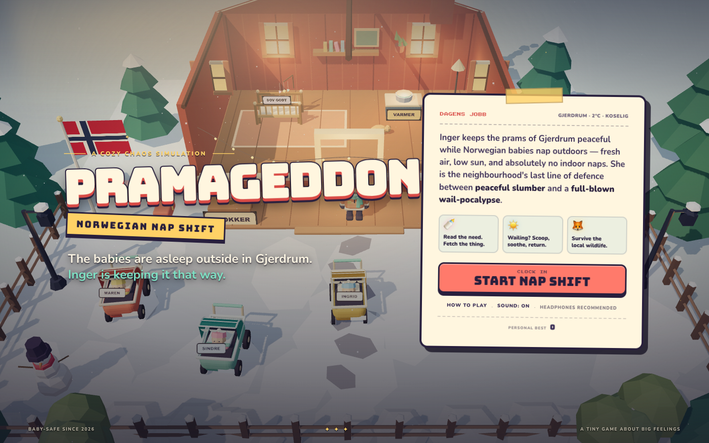
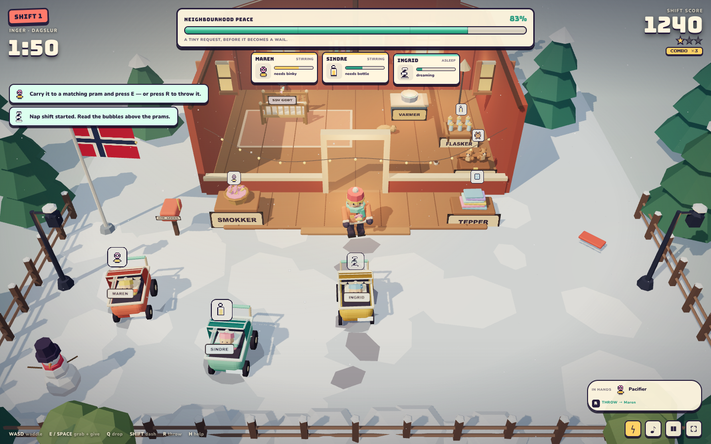

# PRAMAGEDDON — Norwegian Nap Shift

A low-poly, Overcooked-inspired nap-shift game starring Inger, keeping a street full of outdoor-sleeping Norwegian babies peaceful in Gjerdrum under the low winter sun. It is a single-player browser game made with Three.js, Vite, and a fully synthesised chiptune soundtrack.

**Play online:** https://developertheexplorer.github.io/pramageddon/



## Play

```bash
pnpm install
pnpm dev
```

Then open **http://127.0.0.1:4173**.

For a production build:

```bash
pnpm build
pnpm preview
```

## The job

Babies are asleep outside in their prams. Some are dreaming; some are stirring; some are about to make the entire neighbourhood regret its life choices.

- **Read the bubble.** A stirring pram wants a binky, warm bottle, blankie, or teddy.
- **Fetch it.** Binkies and blankies are on the porch. Bottles are inside and need warming on the stove. Teddies are in the chest inside.
- **Or scoop them up.** A wailing baby won't take a snack. Pick them up, carry them to the big crib inside, wait for the shush, then carry them back to their own pram.
- **Dash like a Norwegian with a purpose.** `SHIFT` or the lightning button gives Inger a quick burst of speed, even with a baby in her arms.
- **Yeet responsibly.** `R` or the THROW button tosses the thing in her hands at the nearest valid pram or crib. Thrown items score extra. A thrown baby that misses ends the shift immediately — Gjerdrum is watching.
- **Protect the peace bar.** Crying drains neighbourhood peace. At zero, the neighbours call.
- **Chain soothes.** Consecutive successful soothes build a multiplier up to ×5. Stars are awarded at the end of a shift.

Three shifts from low afternoon sun to blue hour, a Norwegian flag, smokker/tepper/flasker signs, a rude fox, and a personal best saved in local storage.



## Controls

| Input | Action |
| --- | --- |
| `WASD` / arrow keys | Move |
| `E` / `Space` | Pick up, give, tuck in, shoo |
| `Q` | Drop what you're holding |
| `Shift` | Dash |
| `R` | Throw at the nearest valid target |
| `Esc` / `P` | Pause |
| `H` | Help |
| `M` | Mute |

On phones and tablets the game is portrait-first: it switches to a virtual joystick, large `Q` / `THROW` / `E` buttons, a lightning dash button, a follow camera, off-screen pram locators, fullscreen, and notch-aware HUD safe areas.

## Built with

- **Three.js** — all geometry is generated procedurally; no model or texture files are loaded.
- **Vite** — development and production builds.
- **Web Audio API** — the funky pixelated music and all sound effects are synthesised at runtime.
- **Bungee**, **Nunito**, and **Press Start 2P** — bundled locally from Google Fonts (OFL).
